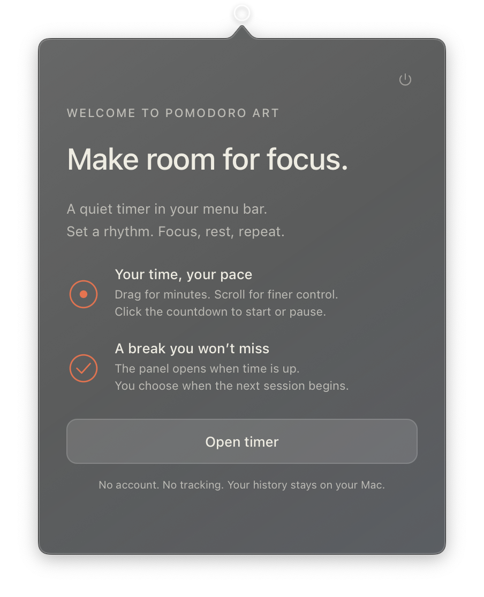

# Pomodoro Art

[English](README.md) | [简体中文](README.zh-CN.md)

一个安静的 macOS 菜单栏番茄钟。专心工作，安心休息，由你决定何时开始下一轮。

<p align="center"></p>

## 安装

[**下载 macOS 版**](https://github.com/wireheadz/PomodoroArt/releases/latest/download/Pomodoro-Art-universal.zip) · [所有版本](https://github.com/wireheadz/PomodoroArt/releases)

需要 **macOS 12 或更高版本**，通用应用支持 Apple Silicon 和 Intel Mac。解压后，将 **Pomodoro Art.app** 移入「应用程序」文件夹并打开。

此社区构建使用本地签名，尚未通过 Apple 公证。macOS 可能阻止首次启动；如果你信任本项目，可前往「系统设置 → 隐私与安全性 → 仍要打开」。详见 [Apple 的说明](https://support.apple.com/102445)，也可按照下方步骤自行构建。

## 专注一会，好好休息。

- 首次启动时，简短的欢迎页会介绍用法。点击「Pomodoro」标题可再次查看。
- 点击菜单栏图标展开磨砂玻璃计时器，点击倒计时开始或暂停。
- 专注最长 **3 小时**，休息最长 **30 分钟**，最短均为 **10 秒**。
- 拖动滑块按整分钟调整；**按住 Shift 拖动**、滚动或使用方向键，可按 10 秒精确调整。
- 时间结束后，面板自动展开，并发出系统通知提示音。准备好后点击「Start break」或「Start focus」。
- 点击面板外部即可收起，计时不会停止。「Reset」重置当前阶段，电源图标用于退出。

圆圈内有点表示专注，有横线表示休息，空圆圈表示空闲。菜单栏不显示倒计时数字。

## 默认保护隐私

无需账号，无分析追踪、服务器或第三方集成。设置与已完成的周期仅保存在 `~/Library/Application Support/Pomodoro Art/`。记录日期跟随 Mac 的本地时区，更新应用会保留现有记录。

首次启动时请允许通知。如果已经拒绝，「Enable notifications」会打开系统设置。专注模式和睡眠可能延迟通知；唤醒后会按实际经过的时间更新计时。

## 从源码构建

安装 Xcode，然后运行：

```sh
git clone https://github.com/wireheadz/PomodoroArt.git
cd PomodoroArt
bash scripts/test.sh
bash scripts/build-app.sh
open dist
```

构建只需要 Xcode。`Sources/PomodoroArt/` 包含应用和本地存储，`Resources/` 包含应用内界面，`Tests/` 包含原生存储测试。构建产物和本地数据不会提交到 Git。

[反馈问题](https://github.com/wireheadz/PomodoroArt/issues)时，请附上 macOS 版本和复现步骤。
